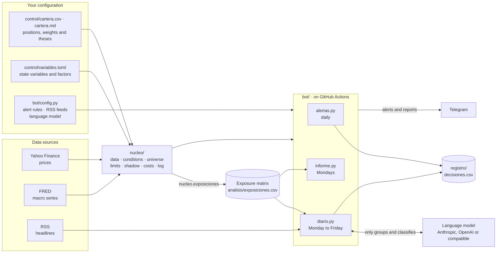

# Financial assistant: portfolio monitoring and alerts

[](https://github.com/iyantp/asistente-financiero/actions/workflows/tests.yml)


[Español](README.md) · **English**

A system that monitors an investment portfolio and sends Telegram alerts only when something that matters happens. It runs unattended on GitHub Actions, with no server of its own, and is made of three programs:

| Program | When | What it does |
|---|---|---|
| **Alerts** (`bot/alertas.py`) | Daily, after the US close | Evaluates your rules on any Yahoo Finance asset (moving-average crossovers, price levels, drawdowns from highs, breakouts, price changes and combinations of them) and reports trend changes, entry and exit signals and alarms. |
| **Daily brief** (`bot/diario.py`) | Monday to Friday, before the open | Reads headlines from your RSS feeds. A language model (Anthropic, OpenAI or any compatible API) only **groups and classifies** them; **rules in code** decide which stories actually moved one of your market variables and affect your portfolio. |
| **Weekly report** (`bot/informe.py`) | Mondays | Notable market variables, how much of the portfolio's week each one explains, risk limits, simulated ideas and the week's events. Pure computation, no AI. |

> Everything personal is configuration: the portfolio, the market variables, the alert rules, the news sources and the language model. What this repository contains is **my configuration, as an example**: anything you don't change stays as it is. The portfolio weights are made up. Nothing here is financial advice.

## Why it exists

It started from two goals. First, to build my own alerts and notifications, tailored to what I find useful, without paying for a service. Second, to automate information: to receive only the news and data that affect what I hold.

## Configuration

| What | Where | Included example |
|---|---|---|
| Portfolio: positions, weights, theses | `control/cartera.csv`, `control/cartera.md` | 7 positions with made-up weights |
| Profile and risk limits | `control/perfil.md`, `nucleo/limites.py` | Crypto + speculation ≤ 15 % |
| Market variables, daily proxies and sector factors | `control/variables.toml` | Real rates, inflation expectations, 2-year yield, dollar, credit, copper, oil and VIX |
| Alert rules | `bot/config.py` (`ACTIVOS`) | S&P 500, Nasdaq 100, gold, rare earths, bitcoin and ether |
| News sources | `bot/config.py` (`FUENTES_RSS`) | Fed, ECB, CNBC, WSJ, FT, CoinDesk… |
| Language model | `bot/config.py` (`DIARIO_PROVEEDOR`, `DIARIO_MODELO`…) | Anthropic, Claude Sonnet |
| Simulated ideas | `bot/config.py` (`SOMBRA`) | Gold with a 12 % stop-loss |
| Event calendar | `control/calendario.csv` | Fed, ECB, US CPI |
| Schedule | Whichever scheduler you use (cron-job.org or GitHub's `schedule`) | Alerts at 23:15, brief at 06:20, report on Mondays at 06:40 (Madrid time) |

Market data comes from Yahoo Finance (prices) and FRED (macroeconomic series).

Code, comments, configuration and messages are in Spanish, as it started as a personal tool. Key terms: *activo* = asset, *cartera* = portfolio, *seguimiento* = tracking, *señal* = signal, *alarma* = alarm, *sombra* = shadow, *límites* = limits, *costes* = costs, *registro* = log, *informe* = report, *diario* = daily.

### Your alert rules

Each rule is one line in `bot/config.py`, on any Yahoo Finance ticker (stocks, ETFs, indices, currencies, commodities, crypto). Some examples:

```python
Activo("Apple", "AAPL", alarma=Nivel(250)),                                    # price goes above $250
Activo("S&P 500 (€)", "SPY", divisa="EURUSD=X", alarma=No(Cruce(75, 500))),    # bearish MA crossover, in euros
Activo("Nasdaq 100", "QQQ", alarma=Variacion(-0.03)),                          # falls 3 % or more in a day
Activo("Oro", "GLD", alarma=CaidaDesdeMaximo(0.15)),                           # 15 % below its one-year high
Activo("Bitcoin", "BTC-USD", continuo=True, alarma=MaximoMovil(252)),          # new one-year high
Activo("Ether", "ETH-USD", continuo=True,
       alarma=Todas((Cruce(6, 20), SinNuevoMinimo(5, 60)))),                   # combination of conditions
```

Besides alarms, an asset can have **tracking** (alerts when a trend changes) and a **strategy** with an entry date (alerts on entry and exit). The available conditions and how to add a new one are in the [manual](docs/bot.en.md#alerts-rules-per-asset).

## Design decisions

- **The model classifies; the code decides.** In the daily brief, the model runs at temperature 0, without web search and on a closed list of headlines; it returns JSON with the affected variable, direction and impact of each story. Relevance is decided in code: a story only gets through if its variable **actually moved** that day, i.e. if the latest change of its daily proxy satisfies $|z_t| \ge 1.5$, with $z_t = (\Delta x_t - \overline{\Delta x})/s_{\Delta x}$, where the mean and standard deviation are those of the changes over the previous 252 sessions (volatility shifts across regimes, so the comparison is against the last year rather than the full history), and if its typical effect on the portfolio is at least 0.1 % per standard deviation. This makes the output reproducible, cheap and independent of the model's "opinion". A test mode (`python bot/diario.py --prueba 3`) classifies the same headlines several times and measures the agreement.
- **A method, not a particular set of variables.** The market is read through a few state variables instead of following "all the news". The variables are defined in `control/variables.toml`, and everything else is derived from there: the exposure matrix, the model's instructions, the news filter and the weekly report. Changing variables means editing that file and regenerating the matrix.
- **The exposure matrix.** It measures how each portfolio asset moves when each variable moves: weekly regressions in euros with standardised variables, Newey-West $t$-statistics and a $|t| > 2.58$ threshold so as not to see relationships where there is only noise. It gives two readings: the typical effect (for news) and the direct exposure (for attributing the week). It is generated with `python -m nucleo.exposiciones`; the method is documented in [`nucleo/exposiciones.py`](nucleo/exposiciones.py) and the full framework (in Spanish) in [`conocimiento/mercado.md`](conocimiento/mercado.md).
- **Validating the data, not just the code.** Since around 2011, Yahoo dates its FX candles at the start of the London day, so the EUR/USD value for day $t$ is really that of the night of $t-1$. I found it by checking against FRED: the correlation of daily changes is 0.19 on the same date and 0.77 with the next candle. Since then the history comes from FRED and only the most recent tail comes from Yahoo, shifted by one candle (`nucleo.datos.alinear_fx`).
- **Measuring whether alerts are useful.** Every alert and every classified story, including the discarded ones as a control group, is logged in `registro/decisiones.csv` with the expected direction of the price. `analisis/evaluar_registro.py` later measures what the price actually did.
- **Ideas before money: the shadow portfolio.** A new idea can be tracked in simulation, with its exit rule from day one and real trading costs (`nucleo/sombra.py`, `nucleo/costes.py`), before investing.
- **A single source of truth and consistency checks.** Each piece of configuration lives in one place, and file paths only in `nucleo/rutas.py`. `python -m nucleo.universo` checks that the portfolio, the variables and the matrix agree with one another; the tests and the weekly report also check the bot's rules, and the report warns when something is out of date (for example, a rule for a position that has been sold).
- **Independent of the AI provider.** `bot/llm.py` talks to the Anthropic API and to any OpenAI-compatible API (OpenAI, Gemini, Mistral, Groq, OpenRouter, Ollama running locally…) using only `requests`.
- **Reliable execution.** GitHub Actions' `schedule` delayed runs by several hours or skipped them, so the workflows are triggered by [cron-job.org](https://cron-job.org) through the GitHub API at the exact time, with a minimum-permission token. The alerts warn before the token expires and when an asset's data goes stale.
- **Reproducibility.** Exact versions in `requirements.lock` for the workflows; tests that need no network or keys (`tests/`), run on every push; a `--demo` mode that prints instead of sending; and an offline mode (`FINANZAS_SIN_RED=1`) that works from local copies of the data.

## Architecture



Dependencies go one way only: `bot/` and `analisis/` use `nucleo/`, and `nucleo/` uses neither.

```
├── control/         your data configuration: cartera.csv, cartera.md, perfil.md, calendario.csv, variables.toml
├── bot/             programs that run unattended
│   ├── config.py        alert rules, shadow portfolio, RSS feeds and language model
│   ├── alertas.py · diario.py · informe.py
│   ├── llm.py           language model call (Anthropic or OpenAI-compatible)
│   └── telegram.py      sending (or printing to the console in demo mode)
├── nucleo/          shared library (installable Python package)
│   ├── datos.py         prices (Yahoo) and series (FRED), conversion to euros, local copies
│   ├── indicadores.py   conditions: Cruce, Nivel, Variacion, CaidaDesdeMaximo, MaximoMovil, MinimoMovil, SinNuevoMinimo, No, Todas, Alguna
│   ├── universo.py      reads the portfolio and the variables; consistency check
│   ├── exposiciones.py  exposure matrix
│   ├── sombra.py        shadow portfolio (simulated ideas with their exit rule)
│   ├── limites.py       risk limits from the profile
│   ├── costes.py        commissions per platform
│   ├── registro.py      decision log
│   ├── backtest.py      Newey-West regression and simulation
│   └── rutas.py         the only place with file paths
├── conocimiento/    market monitoring framework (why these variables)
├── analisis/        exposure matrix and decision-log evaluation
├── registro/        what the bot writes (empty here)
├── tests/           tests with no network or keys
├── docs/            bot manual and setup guide
└── .github/workflows/  alerts, daily brief, weekly report and tests
```

## Quick start

Requires Python 3.10 or later. The demo downloads prices from Yahoo Finance and FRED; it needs no Telegram account and no keys.

```bash
git clone https://github.com/iyantp/asistente-financiero.git
cd asistente-financiero
python -m venv .venv && source .venv/bin/activate      # on Windows: .venv\Scripts\activate
pip install -r requirements.txt                          # dependencies + the `nucleo` package

python tests/test_reglas.py          # tests (no network); or: pip install pytest && pytest -q tests
python -m nucleo.universo            # checks the configuration (variables, portfolio and matrix)
python bot/alertas.py --demo         # alerts and a status summary of each asset, printed to the console
python bot/informe.py --demo         # weekly report, printed to the console
python -m nucleo.exposiciones        # regenerates the exposure matrix
python -m nucleo.limites             # allocation by block and risk limits
python bot/informe.py --sombra       # shadow portfolio
```

The daily brief needs your language model's key (by default, `ANTHROPIC_API_KEY` in the environment or in `.env`): `python bot/diario.py --demo`.

## Running your own bot

The step-by-step guide is in [`docs/bot.en.md`](docs/bot.en.md): Telegram bot, GitHub secrets, language model, scheduling with cron-job.org or GitHub's `schedule`, and adapting the portfolio, variables and rules. In short:

1. Fork (or copy) this repository.
2. Create a bot with @BotFather on Telegram and get your `chat_id`.
3. Add `TELEGRAM_BOT_TOKEN`, `TELEGRAM_CHAT_ID` and, if you want the daily brief, your language model's key as repository secrets.
4. Change whatever you want in the configuration (anything you leave stays as in the example) and, if you changed the portfolio or the variables, regenerate the matrix with `python -m nucleo.exposiciones`.
5. Launch it from *Actions → alertas → Run workflow* and schedule it.

## Limitations

- Yahoo Finance prices are not an official source: days can be missing or the format can change. The bot warns when an asset's data goes stale and, if a download fails, falls back to the last local copy.
- The exposure matrix measures contemporaneous relationships that change with the market regime (which is why it is also estimated from 2022 only). It is a guide for filtering news, not a forecast.
- The decision log needs months of data before anything can be concluded about how useful the alerts are.
- The example rules illustrate the system; they are not recommendations.

## Development

Designed and directed by Iyán Tuñón Pérez, a mathematics student at the University of Oviedo (Spain). The code was written with AI assistance (Claude): the system design, the rules, the variable framework and the validation decisions are mine, and every change was checked with tests and real data before being used.

## License

[MIT](LICENSE).
