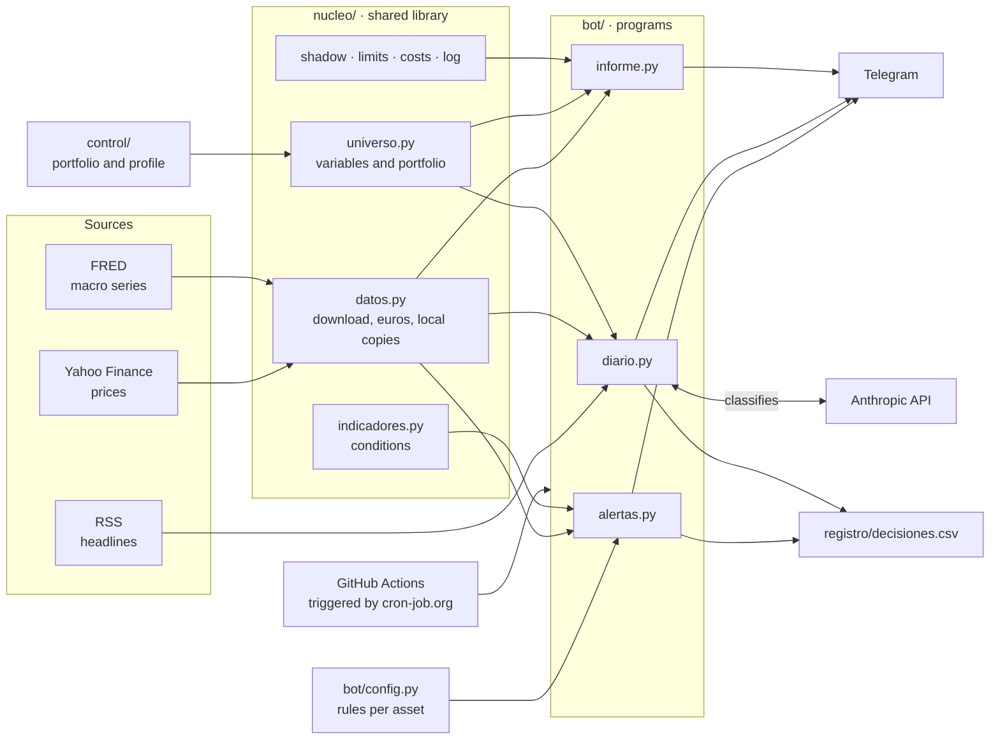

# Financial assistant: portfolio monitoring and alerts

[](https://github.com/iyantp/asistente-financiero/actions/workflows/tests.yml)


[Español](README.md) · **English**

A personal system that monitors an investment portfolio and sends Telegram alerts only when something that matters happens. It runs unattended on GitHub Actions and is made of three programs:

| Program | When | What it does |
|---|---|---|
| **Alerts** (`bot/alertas.py`) | Daily, after the US close | Evaluates configurable rules (moving-average crossovers, price levels, drawdowns from highs and combinations of them) on Yahoo Finance prices converted to euros, and reports trend changes, entry and exit signals and alarms. |
| **Daily brief** (`bot/diario.py`) | Monday to Friday, before the open | Reads headlines from a fixed set of RSS feeds; a language model (Anthropic API) only **groups and classifies** them, and **rules in code** decide which news actually moved a market variable and affects the portfolio. |
| **Weekly report** (`bot/informe.py`) | Mondays | Notable market variables, how much of the portfolio's week each one explains, risk limits from the investor profile, simulated ideas and the week's events. Pure computation, no AI. |

> **About the data.** This repository is the public version of a system I use every day. The portfolio, profile and rules in `control/` and `bot/config.py` are **examples**: the assets are real (so everything works with market data), but the weights, dates and theses are made up. Nothing here is financial advice.

## Why it exists

It started with a specific problem: I had a moving-average crossover strategy to hedge against drawdowns, and I failed to act on it during a week when I wasn't watching the market. The first version only watched that crossover on the S&P 500. It was later generalised into a rule engine for any asset, a news filter and a weekly report, always with the same idea: **automate the attention, not the decision**. No alert is an order; every alert is a prompt to review.

## Design decisions

The interesting part of the project is not the line count but these decisions (and the mistakes they fixed):

- **The model classifies; the code decides.** In the daily brief, the model runs at temperature 0, without web search and on a closed list of headlines; it returns JSON with the affected variable, direction and impact of each story. Relevance is decided in code: a story only gets through if its variable **actually moved** that day, i.e. if the latest change of its daily proxy satisfies $|z_t| \ge 1.5$, with $z_t = (\Delta x_t - \overline{\Delta x})/s_{\Delta x}$, where the mean and standard deviation are those of the changes over the previous 252 sessions (volatility shifts across regimes, so the comparison is against the last year rather than the full history), and if its typical effect on the portfolio is at least 0.1 % per standard deviation. This makes the output reproducible, cheap and independent of the model's "opinion". A test mode (`python bot/diario.py --prueba 3`) classifies the same headlines several times and measures the agreement.
- **A fixed framework of state variables.** A small set of variables (real rates, inflation expectations, the 2-year yield, the dollar against the euro and against a currency basket, credit stress, copper, oil and the VIX) instead of following "all the news". Their effect on each asset is estimated with a weekly regression in euros, with standardised variables, Newey-West $t$-statistics and a $|t| > 2.58$ threshold so as not to see relationships where there is only noise (`analisis/exposiciones.ipynb`). The result is the **exposure matrix** used by the reports. The full framework (in Spanish) is in [`conocimiento/mercado.md`](conocimiento/mercado.md).
- **Validating the data, not just the code.** Since around 2011, Yahoo dates its FX candles at the start of the London day, so the EUR/USD value for day $t$ is really that of the night of $t-1$. I found it by checking against FRED: the correlation of daily changes is 0.19 on the same date and 0.77 with the next candle. Since then the history comes from FRED and only the most recent tail comes from Yahoo, shifted by one candle (`nucleo.datos.alinear_fx`). Before this fix, every euro-denominated price mixed one day's close with the previous day's exchange rate.
- **Avoiding overfitted rules.** The sweep of moving-average combinations (`analisis/archivo/barrido.ipynb`) chooses by looking at the whole history, which is optimistic. `analisis/validacion.py` repeats the choice walk-forward (choose on past years, test on the next segment) to measure that optimism, including commissions and the return on cash (Euribor) while out of the market.
- **Measuring whether alerts are useful.** Every alert and every classified story, including the discarded ones as a control group, is logged in `registro/decisiones.csv` with the expected direction of the price. `analisis/evaluar_registro.py` later measures what the price actually did.
- **Ideas before money: the shadow portfolio.** A new idea can be tracked in simulation, with its exit rule from day one and real trading costs (`nucleo/sombra.py`, `nucleo/costes.py`), before investing.
- **A single source of truth and consistency checks.** Positions live only in `control/cartera.csv`; file paths, only in `nucleo/rutas.py`. `nucleo.universo.coherencia()` checks that the portfolio, the matrix and the bot's rules agree with one another, and the weekly report warns when something is out of date (for example, a rule for a position that has been sold).
- **Reliable execution.** GitHub Actions' `schedule` delayed runs by several hours or skipped them, so the workflows are triggered by [cron-job.org](https://cron-job.org) through the GitHub API at the exact time, with a minimum-permission token. The alerts warn before the token expires and when an asset's data goes stale.
- **Reproducibility.** Exact versions in `requirements.lock` for the workflows; tests that need no network or keys (`tests/`), run on every push; and an offline mode (`FINANZAS_SIN_RED=1`) that works from local copies of the data.

## Architecture



Dependencies go one way only: `bot/` and `analisis/` use `nucleo/`, and `nucleo/` uses neither.

```
├── nucleo/          shared library (installable Python package)
│   ├── datos.py         prices (Yahoo) and series (FRED), conversion to euros, local copies
│   ├── indicadores.py   conditions: Cruce, Nivel, CaidaDesdeMaximo, MinimoMovil, SinNuevoMinimo, No, Todas, Alguna
│   ├── universo.py      state variables, portfolio, factors, consistency check
│   ├── sombra.py        shadow portfolio (simulated ideas with their exit rule)
│   ├── limites.py       risk limits from the profile
│   ├── costes.py        commissions per platform
│   ├── registro.py      decision log
│   ├── backtest.py      simulation and metrics for the analyses
│   └── rutas.py         the only place with file paths
├── bot/             programs that run unattended
│   ├── config.py        rules per asset, shadow portfolio, RSS feeds and model
│   ├── alertas.py · diario.py · informe.py
│   └── telegram.py      sending (or printing to the console in demo mode)
├── control/         the user's decisions: cartera.csv, cartera.md, perfil.md, calendario.csv (examples)
├── conocimiento/    market monitoring framework
├── analisis/        notebooks and scripts; archivo/ keeps superseded analyses
├── registro/        what the bot writes (empty here)
├── tests/           tests with no network or keys
├── docs/            bot manual and setup guide
└── .github/workflows/  alerts, daily brief, weekly report and tests
```

Code, comments and messages are in Spanish, as it is a personal tool. Key terms: *cartera* = portfolio, *alerta* = alert, *señal* = signal, *seguimiento* = tracking, *sombra* = shadow, *límites* = limits, *costes* = costs, *registro* = log, *informe* = report, *diario* = daily.

## Quick start

Requires Python 3.10 or later. The demo downloads prices from Yahoo Finance and FRED; it needs no Telegram account and no keys.

```bash
git clone https://github.com/iyantp/asistente-financiero.git
cd asistente-financiero
python -m venv .venv && source .venv/bin/activate      # on Windows: .venv\Scripts\activate
pip install -r requirements.txt                          # dependencies + the `nucleo` package

python tests/test_reglas.py          # tests (no network); or: pip install pytest && pytest -q tests
python bot/alertas.py --demo         # alerts and a status summary of each asset, printed to the console
python bot/informe.py --demo         # weekly report, printed to the console
python -m nucleo.limites             # allocation by block and risk limits
python -m nucleo.costes 5000         # cost of buying and selling €5,000 of an ETF
python bot/informe.py --sombra       # shadow portfolio
```

The daily brief needs an Anthropic API key (`ANTHROPIC_API_KEY` in the environment or in `.env`): `python bot/diario.py --demo`.

For the analyses: `pip install -r requirements-analisis.txt` and `jupyter notebook analisis/`, or `python analisis/validacion.py SPY EURUSD=X`.

## Running your own bot

The step-by-step guide (Telegram bot, GitHub secrets, Anthropic key, scheduling with cron-job.org or GitHub's `schedule`, and adapting the portfolio and rules) is in [`docs/bot.en.md`](docs/bot.en.md). In short:

1. Fork (or copy) this repository.
2. Create a bot with @BotFather on Telegram and get your `chat_id`.
3. Add `TELEGRAM_BOT_TOKEN`, `TELEGRAM_CHAT_ID` and, if you want the daily brief, `ANTHROPIC_API_KEY` as repository secrets.
4. Edit `control/cartera.csv` and `bot/config.py` with your assets and rules, and re-run `analisis/exposiciones.ipynb`.
5. Launch it from *Actions → alertas → Run workflow* and schedule it.

## Included analyses

| Analysis | Question |
|---|---|
| `analisis/archivo/analisis.ipynb` | What would moving-average crossover strategies have done on the S&P 500 and gold, in euros and with execution delay and commissions, compared with buy and hold? |
| `analisis/archivo/barrido.ipynb` | Are there average combinations that return almost as much as buy and hold with much less volatility? Are they stable over time? |
| `analisis/validacion.py` | How much does the sweep overstate what can be expected out of sample (walk-forward)? |
| `analisis/exposiciones.ipynb` | How does each asset move when each state variable moves? (generates the exposure matrix) |
| `analisis/candidatas.ipynb` | Are there variables that explain an asset better than the state variables? |
| `analisis/riesgo_cartera.py` | Volatility and drawdowns of the portfolio as a whole, risk contributions, hedging the dollar or not, stress episodes. |
| `analisis/evaluar_registro.py` | Were the alerts and the news classification right? |

## Limitations

- Yahoo Finance prices are not an official source: days can be missing or the format can change. The bot warns when an asset's data goes stale and, if a download fails, falls back to the last local copy.
- The exposure-matrix regressions change with the market regime (they are estimated from 2012 and from 2022). They are a guide for filtering news, not a forecast.
- The decision log needs months of data before anything can be concluded about how useful the alerts are.
- The example rules illustrate the system; they are not recommendations.

## Development

Designed and directed by Iyán Tuñón Pérez, a mathematics student at the University of Oviedo (Spain). The code was written with AI assistance (Claude): the system design, the rules, the variable framework and the validation decisions are mine, and every change was checked with tests and real data before being used.

## License

[MIT](LICENSE).
