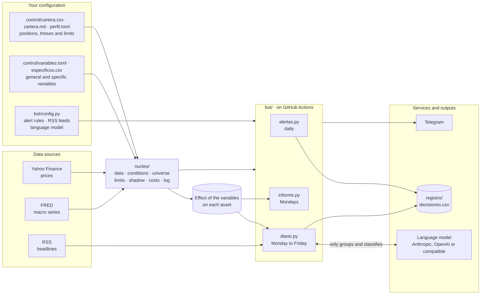

# Financial assistant

[](https://github.com/iyantp/asistente-financiero/actions/workflows/tests.yml)


[Español](README.md) · **English**

An assistant that watches your investments and messages you on Telegram **only when something that matters happens**. It runs by itself on GitHub, with no computer left on and no server of your own, and does three things:

1. **Alerts with your own rules.** "Tell me if gold falls 15 % from its high", "if the S&P 500 drops below its 200-session average", "if bitcoin makes a one-year high". What you would do with a paid service such as TradingView, on any Yahoo Finance asset.
2. **A filtered news brief.** Every morning it reads the headlines from the sources you choose and sends you only the ones that affect what you hold, with the reason why. An AI sorts the headlines; fixed rules decide what matters to you, so it is predictable.
3. **A system to understand what moves your portfolio.** It measures how the big market variables (interest rates, the dollar, inflation, oil…) affect each of your assets, and how your assets relate to one another. Every Monday a report explains what moved your portfolio that week.

> Everything personal is configuration: your portfolio, your rules, your sources, your variables and the AI provider. What you see here is **my configuration, as an example**: anything you don't change stays as it is. The portfolio weights are made up. Nothing here is financial advice.

## Why it exists

It started from two goals. First, to build my own alerts and notifications, tailored to what I find useful, without paying for a service. Second, to automate information: to receive only the news and data that affect what I hold.

## How it understands the market

The assistant does not follow "all the news". It uses two kinds of variables:

- **General variables**, which move every asset: the world stock market, interest rates, credit, inflation, the dollar, commodities…
- **Specific variables** for one or a few particular assets, covering what the general ones miss: miners and the Chinese stock market for a lithium fund, or the Nasdaq for bitcoin.

Using historical data, it measures how much each of your assets moves when each variable moves. That gives three things:
- **Which news affects you:** a story only gets through if it moves a variable that moves your portfolio, and if that variable actually moved.
- **What explains your week:** Monday's report splits the portfolio's move across the variables.
- **Why your assets move together,** which matters for knowing whether you are really diversified.

The variables in this repository are mine, as an example; the method works with whichever you choose. The technical detail is in the [appendix](#technical-appendix).

## Try it

You need Python 3.10 or later. The demo downloads prices from the internet; no Telegram account or keys are needed.

```bash
git clone https://github.com/iyantp/asistente-financiero.git
cd asistente-financiero
python -m venv .venv
source .venv/bin/activate
pip install -r requirements.txt
python bot/alertas.py --demo
python bot/informe.py --demo
```

On Windows, the fourth line is `.venv\Scripts\activate`. The last two print the alerts and the weekly report for the example portfolio. The news brief needs an AI key (by default, `ANTHROPIC_API_KEY`): `python bot/diario.py --demo`.

Code, configuration and messages are in Spanish, as it started as a personal tool. Key terms: *activo* = asset, *cartera* = portfolio, *alarma* = alarm, *seguimiento* = tracking, *señal* = signal, *informe* = report, *diario* = daily.

## Make it yours

| What | Where |
|---|---|
| Your portfolio: positions, weights and the currency of each | `control/cartera.csv` (a table: edit it in Excel or any editor) |
| Your theses and exit conditions, in free text (the news brief takes them into account) | `control/cartera.md` |
| Your alert rules | `bot/config.py` |
| Your news sources | `bot/config.py` (`FUENTES_RSS`) |
| The AI provider (Anthropic, OpenAI, Gemini, a model on your computer…) | `bot/config.py` (`DIARIO_*`) |
| Your market variables: general ones and those specific to an asset | `control/variables.toml` and `control/especificos.csv` |
| Your portfolio blocks, risk limits and broker commissions | `control/perfil.toml` |
| The week's events (Fed, ECB, CPI…) | `control/calendario.csv` |
| When each message arrives | Whichever scheduler you use (see the guide) |

### Your alert rules

Each rule is one line in `bot/config.py`:

```python
Activo("Apple", "AAPL", alarma=Nivel(250)),                               # price goes above $250
Activo("Nasdaq 100", "QQQ", alarma=Variacion(-0.03)),                     # falls 3 % or more in a day
Activo("Oro", "GLD", alarma=CaidaDesdeMaximo(0.15)),                      # 15 % below its one-year high
Activo("Bitcoin", "BTC-USD", continuo=True, alarma=MaximoMovil(252)),     # new one-year high
Activo("S&P 500 (€)", "SPY", divisa="EURUSD=X", alarma=No(Cruce(75, 500))),   # moving-average cross, in euros
```

Conditions can be combined ("this and that", "this or that"). An asset can also have **tracking** (alerts you when a trend changes) and a **strategy** with a purchase date (alerts you on entry and exit). All the conditions are in the [manual](docs/bot.en.md#alerts-rules-per-asset).

### Running your own bot

The step-by-step guide is in [`docs/bot.en.md`](docs/bot.en.md). In short:
1. Copy (*fork*) this repository.
2. Create a Telegram bot with @BotFather.
3. Save the bot's token, your chat number and, if you want the news brief, your AI key as repository *secrets*.
4. Change whatever configuration you want.
5. Launch it from the *Actions* tab and schedule it.

## Limitations

- Prices come from Yahoo Finance, which is not an official source: days are sometimes missing. The bot warns you when an asset's data goes stale.
- The relationships between variables and assets change over time. They are for filtering and understanding, not for forecasting.
- It takes months of use before you can measure whether the alerts are right (the system logs them so this can be checked).
- The example rules illustrate the system; they are not recommendations.

## Development

Designed and directed by Iyán Tuñón Pérez, a mathematics student at the University of Oviedo (Spain). The code was written with AI assistance (Claude): the system design, the rules, the variable framework and the validation decisions are mine, and every change was checked with tests and real data before being used.

[MIT](LICENSE) license.

---

## Technical appendix

### A. How the effect of the variables is measured

**In production: the exposure matrix** (`nucleo/exposiciones.py`, `python -m nucleo.exposiciones`). The general variables are defined in `control/variables.toml`, and the specific factors in `control/especificos.csv`. For each portfolio asset and each general variable, the matrix estimates from weekly data in euros how much the asset moves when the variable moves by one standard deviation, in two readings:
- **Typical effect**, $\gamma_k$: simple regression, including how the other variables usually move at the same time. The daily brief uses it for news.
- **Direct exposure**, $\beta_k$: multiple regression, holding the others fixed. The weekly report uses it to attribute the week.

They are related by $\gamma_k = \sum_j \beta_j \rho_{jk}$. Inference: Newey-West $t$-statistics, with a $|t| > 2.58$ threshold.

**Under construction: a risk factor model** (`control/factores.toml`, `nucleo/factores.py`), in the style of Barra's models or Two Sigma's *Factor Lens*. Each asset is described as

$$r_{a,t} = \alpha_a + \sum_k \beta_{a,k}\, f_{k,t} + \varepsilon_{a,t},$$

which also gives the correlation between assets, $\Sigma = B\,\Omega\,B^\top + D$. Compared with the matrix:
- **Tradable factors with daily data** (ETFs and differences between ETFs) instead of macroeconomic series published with a lag.
- **Orthogonalisation in a chosen order** (Gram-Schmidt), so that overlapping factors, such as the euro and the dollar, do not split the credit unstably.
- **Specific factors** shared by the positions they explain and cleaned of the general ones. If a position had its factor to itself, the part it shares with others would be left as its own risk and their correlation would be lost (for bitcoin and ether, the model would give 0.13 instead of the actual 0.82).
- **Exact currency conversion,** instead of estimating it as one more factor.

Still to come: time-varying exposures, shrinking the estimates towards reference values, separating correlations in calm and stressed markets (VIX, MOVE and credit spread), and validating the model against what happens next.

### B. Design decisions

- **The language model classifies; the code decides.** The daily brief runs the model at temperature 0, without web search and on a closed list of headlines; the model returns JSON with the affected variable, direction and impact of each story. A story only gets through if its variable actually moved that day: the latest change of its daily proxy must satisfy $|z_t| \ge 1.5$, where $z_t = (\Delta x_t - \overline{\Delta x})/s_{\Delta x}$ against the previous 252 sessions. Its typical effect on the portfolio must also be at least 0.1 % per standard deviation. `python bot/diario.py --prueba 3` measures how consistent the classification is.
- **Independent of the AI provider.** `bot/llm.py` talks to the Anthropic API and to any OpenAI-compatible API using only `requests`.
- **Validating the data, not just the code.** Two examples:
  - Yahoo dates FX candles at the start of the London day, so the EUR/USD value for day $t$ is really that of the night of $t-1$: the correlation of daily changes with FRED is 0.19 on the same date and 0.77 with the next candle. This is fixed in `nucleo.datos.alinear_fx`.
  - URTH (MSCI World) barely traded in 2012–2014: 151 unchanged days in 2012 and a 0.29 correlation with the S&P 500. Its data is only used from 2015.
- **Measuring whether alerts are useful.** Every alert and every classified story, including the discarded ones as a control group, is logged in `registro/decisiones.csv` with the expected direction of the price. `analisis/evaluar_registro.py` later measures what the price actually did.
- **Ideas before money.** The shadow portfolio (`nucleo/sombra.py`) tracks ideas in simulation, with their exit rule from day one and real trading costs (`nucleo/costes.py`).
- **A single source of truth and consistency checks.** Each piece of configuration lives in one place. `python -m nucleo.universo` checks that the portfolio, variables and matrix agree; the tests and the weekly report also check the bot's rules.
- **Reliable execution.** GitHub Actions' `schedule` delayed or skipped runs, so the workflows are triggered by [cron-job.org](https://cron-job.org) through the GitHub API, with a minimum-permission token. The alerts warn before the token expires.
- **Reproducibility.** Exact versions in `requirements.lock`; tests with no network or keys on every push; a `--demo` mode; an offline mode (`FINANZAS_SIN_RED=1`) with local copies of the data.

### C. Architecture



Dependencies go one way only: `bot/` and `analisis/` use `nucleo/`, and `nucleo/` uses neither.

```
├── control/         your configuration: cartera.csv (positions), cartera.md (theses), perfil.toml (blocks, limits,
│                    commissions), variables.toml and especificos.csv (variables), calendario.csv (events),
│                    factores.toml (factor model, under construction)
├── bot/             programs that run unattended
│   ├── config.py        alert rules, shadow portfolio, RSS feeds and language model
│   ├── alertas.py · diario.py · informe.py
│   ├── llm.py           language model call (Anthropic or OpenAI-compatible)
│   └── telegram.py      sending (or printing to the console in demo mode)
├── nucleo/          shared library (installable Python package)
│   ├── datos.py         prices (Yahoo) and series (FRED), currency conversion, local copies
│   ├── indicadores.py   alert conditions
│   ├── universo.py      reads the portfolio, variables and specific factors; consistency check
│   ├── perfil.py        reads blocks, limits and commissions
│   ├── exposiciones.py  exposure matrix (in production)
│   ├── factores.py      factor model (under construction)
│   ├── sombra.py · limites.py · costes.py · registro.py · backtest.py
│   └── rutas.py         the only place with file paths
├── analisis/        exposure matrix and decision-log evaluation
├── registro/        what the bot writes (empty here)
├── tests/           tests with no network or keys
├── docs/            bot manual and setup guide
└── .github/workflows/  alerts, daily brief, weekly report and tests
```

### D. Useful commands

```bash
python tests/test_reglas.py          # tests (no network)
python -m nucleo.universo            # does the configuration agree?
python -m nucleo.exposiciones        # regenerates the exposure matrix
python -m nucleo.limites             # allocation by block and risk limits
python -m nucleo.costes 5000         # cost of buying and selling €5,000 of an ETF
python bot/informe.py --sombra       # shadow portfolio
python bot/diario.py --prueba 3      # consistency of the news classification
```
