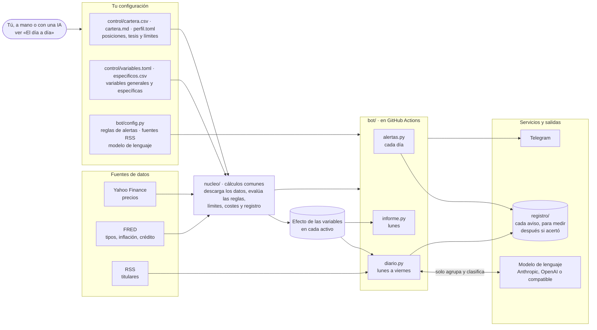

# Asistente financiero

[](https://github.com/iyantp/asistente-financiero/actions/workflows/tests.yml)


**Español** · [English](README.en.md)

Un asistente que vigila tus inversiones y te avisa por Telegram **solo cuando pasa algo que importa**. Funciona solo, en GitHub, sin ordenador encendido ni servidor propio, y hace tres cosas:

1. **Alertas con tus propias reglas.** «Avísame si el oro cae un 15 % desde su máximo», «si el S&P 500 pierde su media de 200 sesiones», «si el bitcoin marca un máximo anual». Lo que harías con un servicio de pago como TradingView, sobre cualquier activo de Yahoo Finance.
2. **Un resumen de noticias filtrado.** Cada mañana lee los titulares de las fuentes que elijas y te manda solo los que afectan a lo que tienes, con el motivo. Una IA ordena los titulares; la decisión de qué te importa la toman reglas fijas, así que es predecible.
3. **Un sistema para entender qué mueve tu cartera.** Mide cómo afectan las grandes variables del mercado (tipos de interés, dólar, inflación, petróleo…) a cada uno de tus activos y cómo se relacionan tus activos entre sí. Cada lunes te explica en un informe qué ha movido tu cartera esa semana.

> Todo lo personal es configuración: tu cartera, tus reglas, tus fuentes, tus variables y el proveedor de IA. Lo que hay aquí es **una configuración de ejemplo**, con una cartera típica inventada: lo que no cambies se queda así. Nada de esto es asesoramiento financiero.

## Por qué existe

El proyecto parte de dos objetivos. El primero, disponer de un sistema propio de alertas sobre los mercados, configurable sin limitaciones y sin depender de un servicio de pago. El segundo, automatizar la información financiera: recibir únicamente las noticias y los datos que afectan a la cartera.

El segundo objetivo plantea el problema de fondo. El volumen de noticias financieras es elevado, su relevancia es muy desigual y rara vez indican qué efecto tienen sobre una cartera concreta. Una subida del petróleo o un cambio de tono de la Reserva Federal afectan a unos activos y no a otros, y ese efecto depende de relaciones que la noticia no explica. Filtrar por la importancia aparente de un titular, o por el criterio de quien lo publica, no resuelve esa cuestión.

El asistente aplica en su lugar un criterio explícito y medible. Para cada titular comprueba tres condiciones:

1. **Qué variable de mercado afecta** (tipos de interés, dólar, inflación, petróleo…) y en qué dirección. Esta clasificación es la única tarea que se delega en un modelo de lenguaje.
2. **Si esa variable se ha movido de forma significativa** ese día respecto a su comportamiento habitual. Una noticia que el mercado ya esperaba no altera los precios.
3. **Si la cartera es sensible a esa variable**, según la relación histórica entre la variable y cada activo.

Solo se notifican las noticias que cumplen las tres. Las dos últimas condiciones se evalúan con datos, no con la interpretación del modelo de lenguaje ni con la del autor de la noticia, de modo que el filtro es predecible, reproducible y verificable. Cada notificación indica la variable afectada, la magnitud de su movimiento y las posiciones expuestas; los titulares destacados que se descartan se listan con el motivo. Todas las decisiones, incluidas las descartadas, quedan registradas para evaluar la precisión del filtro con el tiempo.

## Cómo entiende el mercado

El asistente no sigue «todas las noticias». Usa dos tipos de variables:

- **Variables generales**, que mueven a todos los activos: la bolsa mundial, los tipos de interés, el crédito, la inflación, el dólar, las materias primas…
- **Variables específicas** de uno o pocos activos concretos, para lo que las generales no explican: las mineras y la bolsa china para un fondo de litio, o el Nasdaq para el bitcoin.

Con datos históricos mide cuánto se mueve cada uno de tus activos cuando se mueve cada variable. De ahí salen tres cosas:
- **Qué noticias te afectan:** una noticia solo pasa el filtro si mueve una variable que mueve tu cartera y si esa variable se ha movido de verdad.
- **Qué explica tu semana:** el informe del lunes reparte el movimiento de la cartera entre las variables.
- **Por qué tus activos se mueven juntos,** cosa que importa para saber si de verdad estás diversificado.

Las variables de este repositorio son las mías, como ejemplo; el método funciona con las que tú elijas. El detalle técnico está en el [apéndice](#apéndice-técnico).

## Pruébalo

Necesitas Python 3.10 o superior. La demo descarga precios de internet; no hace falta Telegram ni ninguna clave.

```bash
git clone https://github.com/iyantp/asistente-financiero.git
cd asistente-financiero
python -m venv .venv
source .venv/bin/activate
pip install -r requirements.txt
python bot/alertas.py --demo
python bot/informe.py --demo
```

En Windows, la cuarta línea es `.venv\Scripts\activate`. Las dos últimas muestran por pantalla las alertas y el informe semanal de la cartera de ejemplo. El resumen de noticias necesita una clave de IA (por defecto, `ANTHROPIC_API_KEY`): `python bot/diario.py --demo`.

## Configúralo para ti

| Qué | Dónde |
|---|---|
| Tu cartera: posiciones, pesos y en qué moneda está cada una | `control/cartera.csv` (una tabla: se edita en Excel o en cualquier editor) |
| Tus tesis y condiciones de salida, en texto libre (el resumen de noticias las tiene en cuenta) | `control/cartera.md` |
| Tus reglas de alertas | `bot/config.py` |
| Tus fuentes de noticias | `bot/config.py` (`FUENTES_RSS`) |
| El proveedor de IA (Anthropic, OpenAI, Gemini, un modelo en tu ordenador…) | `bot/config.py` (`DIARIO_*`) |
| Tus variables de mercado: generales y específicas de algún activo | `control/variables.toml` y `control/especificos.csv` |
| Los bloques de tu cartera, tus límites de riesgo y las comisiones de tu bróker | `control/perfil.toml` |
| Eventos de la semana (Fed, BCE, IPC…) | `control/calendario.csv` |
| A qué hora llega cada cosa | El programador que uses (ver la guía) |
| Instrucciones para que una IA mantenga todo lo anterior | `ia/asistente-financiero/SKILL.md` (ver [El día a día](#el-día-a-día)) |

### Tus reglas de alertas

Cada regla es una línea de `bot/config.py`, que está pensado para eso: arriba tiene una chuleta con todas las condiciones y debajo las reglas, separadas del resto. Por ejemplo:

```python
# El precio de Apple supera 250 $
Activo("Apple", "AAPL", alarma=Nivel(250)),

# El Nasdaq 100 cae un 3 % o más en un día
Activo("Nasdaq 100", "QQQ", alarma=Variacion(-0.03)),

# El oro está un 15 % o más por debajo de su máximo de un año
Activo("Oro", "GLD", alarma=CaidaDesdeMaximo(0.15)),

# El bitcoin marca un máximo de un año (cotiza todos los días)
Activo("Bitcoin", "BTC-USD", continuo=True, alarma=MaximoMovil(252)),

# El S&P 500, medido en euros, pierde su media de 200 sesiones
Activo("S&P 500 (€)", "SPY", divisa="EURUSD=X", alarma=No(Cruce(1, 200))),
```

Las condiciones se combinan («esto y aquello», «esto o aquello»). Un activo también puede tener **seguimiento** (te avisa cuando cambia una tendencia) y una **estrategia** con fecha de compra (te avisa de la entrada y de la salida).

Puedes escribir las reglas a mano o pedírselas a una IA en lenguaje normal («avísame si el oro cae un 10 % desde su máximo»): el repositorio incluye las instrucciones para que lo haga bien (ver [El día a día](#el-día-a-día)). Si una regla está mal escrita, `python -m nucleo.universo` te dice cuál y por qué, y `python bot/alertas.py --demo` te enseña los avisos que saldrían hoy. Todas las condiciones están en el [manual](docs/bot.md#alertas-reglas-por-activo); si te falta alguna, se añade como una pieza nueva sin tocar las demás.

### Montar tu propio bot

La guía paso a paso está en [`docs/bot.md`](docs/bot.md#puesta-en-marcha-paso-a-paso). En resumen:
1. Pulsa **Use this template → Create a new repository** y elige **Private**: así tu cartera no queda a la vista. (Un *fork* de un repositorio público es siempre público.)
2. Crea un bot de Telegram con @BotFather.
3. Guarda el token del bot, tu número de chat y, si quieres el resumen de noticias, la clave de tu IA como *secrets* del repositorio.
4. Pon tu cartera y tus reglas.
5. Lánzalo desde la pestaña *Actions* y prográmalo.

## El día a día

Una vez montado, el bot funciona solo: cada noche revisa tus reglas, cada mañana te manda las noticias que te afectan y cada lunes el informe. Lo único que tienes que hacer tú es **mantener al día tu cartera**, porque el filtro de noticias, el informe y los límites se calculan con ella. El bot usa lo que hay en GitHub, así que cada cambio cuenta desde que lo subes.

**La forma más sencilla: pedírselo a una IA.** Abre el repositorio con un asistente que pueda trabajar con archivos (Claude, Codex, Cursor, Copilot…) y díselo como se lo dirías a una persona:

- «He vendido la mitad del oro; ahora la cartera vale 12.000 € y el oro, 600 €.»
- «Avísame si el bitcoin cae un 10 % en una semana.»
- «Quiero añadir un fondo de mercados emergentes con un 5 %; ¿me salta algún límite?»

El repositorio incluye instrucciones para la IA ([`ia/asistente-financiero/SKILL.md`](ia/asistente-financiero/SKILL.md); [`AGENTS.md`](AGENTS.md) y [`CLAUDE.md`](CLAUDE.md) apuntan a ellas, así que Claude Code y la mayoría de asistentes las leen solos). Con ellas, la IA sabe qué archivo tocar en cada caso, recalcula los pesos, comprueba tus límites y el coste de la operación, escribe la regla, verifica que todo cuadra y te deja el cambio listo para subir. Nunca guarda importes en euros: la cartera se guarda en pesos. En la app de Claude también puedes subir esa carpeta como *skill*.

**Sin IA y sin instalar nada.** Edita `control/cartera.csv` o `bot/config.py` directamente en github.com (el botón del lápiz) y guarda. Al subir el cambio, un workflow (`matriz`) recalcula lo que depende de la cartera y comprueba que todo cuadra; si algo está mal, la ejecución queda en rojo y GitHub te avisa por correo.

**Cada trimestre:** añade a `control/calendario.csv` las fechas de los próximos bancos centrales y datos de inflación, y repasa tus notas de `control/cartera.md`.

## Limitaciones

- Los precios vienen de Yahoo Finance, que no es una fuente oficial: a veces faltan días. Las series macroeconómicas (tipos de interés, inflación esperada, diferenciales de crédito) vienen de [FRED](https://fred.stlouisfed.org), la base de datos pública y gratuita de la Reserva Federal de St. Louis. El bot te avisa si los datos de un activo se quedan atrasados.
- Las relaciones entre variables y activos cambian con el tiempo. Sirven para filtrar y entender, no para predecir.
- Hacen falta meses de uso antes de poder medir si las alertas aciertan (el sistema las va registrando para comprobarlo).
- Las reglas de ejemplo ilustran el sistema; no son recomendaciones.

## Desarrollo

El código se ha escrito con asistencia de IA (Claude): el diseño del sistema, las reglas, el marco de variables y las decisiones de validación son míos, y cada cambio se ha comprobado con pruebas y con datos reales antes de usarlo. El código está en español porque nació como herramienta de uso personal.

Licencia [MIT](LICENSE).

---

## Apéndice técnico

### A. Cómo se mide el efecto de las variables

**En producción: la matriz de exposición** (`nucleo/exposiciones.py`, `python -m nucleo.exposiciones`). Las variables generales se definen en `control/variables.toml` y los factores específicos en `control/especificos.csv`. Para cada activo de la cartera y cada variable general, la matriz estima con datos semanales en euros cuánto se mueve el activo cuando la variable se mueve una desviación típica, en dos lecturas:
- **Efecto típico**, $\gamma_k$: regresión simple, que incluye cómo se mueven a la vez las demás variables. Es la que usa el resumen diario para las noticias.
- **Exposición directa**, $\beta_k$: regresión múltiple, con las demás fijas. Es la que usa el informe semanal para atribuir la semana.

Se relacionan por $\gamma_k = \sum_j \beta_j \rho_{jk}$. Inferencia: estadísticos $t$ de Newey-West, con un umbral de $|t| > 2{,}58$.

**En construcción: un modelo de factores de riesgo** (`control/factores.toml`, `nucleo/factores.py`), al estilo de los modelos de Barra o del *Factor Lens* de Two Sigma. Cada activo se describe como

$$r_{a,t} = \alpha_{a,t} + \sum_k \beta_{a,k,t}\, f_{k,t} + \varepsilon_{a,t},$$

y de ahí sale también la correlación entre activos, $\Sigma = B\,\Omega\,B^\top + D$. Frente a la matriz:
- **Factores negociables con dato diario** (ETF y diferencias entre ETF) en lugar de series macroeconómicas que se publican con retraso.
- **Ortogonalización en un orden elegido** (Gram-Schmidt), para que factores solapados, como el euro y el dólar, no se repartan el mérito de forma inestable.
- **Factores específicos** compartidos por las posiciones a las que explican y limpios de los generales. Si una posición tuviera su factor en exclusiva, la parte que comparte con otras quedaría como riesgo propio y se perdería su correlación (con el bitcoin y el ether, el modelo daría 0,12 en lugar del 0,79 real).
- **Conversión de divisa exacta,** en vez de estimada como un factor más.
- **Calendario común:** factores y activos se toman en las mismas sesiones; lo que cotiza en fin de semana (cripto) acumula esos días en el lunes en vez de perderlos.
- **Exposiciones que cambian con el tiempo,** estimadas con medias exponenciales (vida media de un año). Fuera de muestra, explican el día siguiente mejor que unas $\beta$ fijas: el error sin explicar baja hasta un 20 % según el activo.

Está pendiente contraer las estimaciones hacia valores de referencia, separar las correlaciones en calma y en tensión (VIX, MOVE y diferencial de crédito) y validar el modelo frente a lo que ocurre después.

### B. Decisiones de diseño

- **El modelo de lenguaje clasifica; el código decide.** El resumen diario usa el modelo a temperatura 0, sin búsqueda web y sobre una lista cerrada de titulares; el modelo devuelve un JSON con la variable afectada, la dirección y el impacto de cada noticia. Una noticia solo pasa si su variable se ha movido de verdad ese día: el último cambio de su aproximación diaria debe cumplir $|z_t| \ge 1{,}5$, donde $z_t = (\Delta x_t - \overline{\Delta x})/s_{\Delta x}$ frente a las 252 sesiones anteriores. Además, su efecto típico sobre la cartera debe ser de al menos un 0,1 % por desviación típica. `python bot/diario.py --prueba 3` mide la consistencia de la clasificación.
- **Independiente del proveedor de IA.** `bot/llm.py` habla con la API de Anthropic y con cualquier API compatible con la de OpenAI solo con `requests`.
- **Validación de los datos, no solo del código.** Dos ejemplos:
  - Yahoo fecha las velas de divisas al inicio del día en Londres, así que el EUR/USD del día $t$ es el de la noche de $t-1$: la correlación de los cambios con FRED es de 0,19 en la misma fecha y de 0,77 con la vela siguiente. Se corrige en `nucleo.datos.alinear_fx`.
  - URTH (MSCI World) apenas se negoció en 2012–2014: 151 días sin cambio en 2012 y una correlación de 0,29 con el S&P 500. Sus datos solo se usan desde 2015.
- **Medir si las alertas sirven.** Cada alerta y cada noticia clasificada, incluidas las descartadas como grupo de control, se guarda en `registro/decisiones.csv` con la dirección que se espera del precio. `analisis/evaluar_registro.py` mide después qué hizo el precio.
- **Ideas antes que dinero.** La cartera sombra (`nucleo/sombra.py`) sigue ideas en simulación, con su regla de salida desde el primer día y costes reales de operar (`nucleo/costes.py`).
- **Una sola fuente de verdad y comprobaciones de coherencia.** Cada dato de configuración vive en un solo sitio. `python -m nucleo.universo` comprueba que cartera, variables y matriz cuadran; las pruebas y el informe semanal comprueban además las reglas del bot.
- **Ejecución fiable.** El `schedule` de GitHub Actions retrasaba o saltaba ejecuciones, así que los workflows los lanza [cron-job.org](https://cron-job.org) por la API de GitHub, con un token de permisos mínimos. Las alertas avisan antes de que el token caduque.
- **Reproducibilidad.** Versiones exactas en `requirements.lock`; pruebas sin red ni claves en cada push; modo `--demo`; modo sin conexión (`FINANZAS_SIN_RED=1`) con copias locales de los datos.

### C. Arquitectura



Las dependencias van en un solo sentido: `bot/` y `analisis/` usan `nucleo/`, y `nucleo/` no usa a ninguno de los dos.

```
├── control/         tu configuración: cartera.csv (posiciones), cartera.md (tesis), perfil.toml (bloques, límites,
│                    comisiones), variables.toml y especificos.csv (variables), calendario.csv (eventos),
│                    factores.toml (modelo de factores, en construcción)
├── bot/             programas que se ejecutan solos
│   ├── config.py        reglas de alertas, cartera sombra, fuentes RSS y modelo de lenguaje
│   ├── alertas.py · diario.py · informe.py
│   ├── llm.py           llamada al modelo de lenguaje (Anthropic o compatible con OpenAI)
│   └── telegram.py      envío (o impresión por pantalla en modo demo)
├── nucleo/          biblioteca común (paquete Python instalable)
│   ├── datos.py         precios (Yahoo) y series (FRED), conversión de divisa, copias locales
│   ├── indicadores.py   condiciones de las alertas
│   ├── reglas.py        el tipo Activo, que comprueba que cada regla está bien escrita
│   ├── universo.py      lee cartera, variables y específicos; comprobación de coherencia
│   ├── perfil.py        lee bloques, límites y comisiones
│   ├── exposiciones.py  matriz de exposición (en producción)
│   ├── factores.py      modelo de factores (en construcción)
│   ├── sombra.py · limites.py · costes.py · registro.py · backtest.py
│   └── rutas.py         único sitio con rutas de archivos
├── analisis/        matriz de exposición y evaluación del registro
├── registro/        lo que escribe el bot (aquí, vacío)
├── tests/           pruebas sin red ni claves
├── docs/            manual del bot y guía de puesta en marcha
├── ia/              instrucciones para que una IA mantenga la configuración (AGENTS.md y CLAUDE.md apuntan aquí)
└── .github/workflows/  alertas, diario e informe (programados); matriz y tests (al subir cambios)
```

### D. Comandos útiles

```bash
python tests/test_reglas.py          # pruebas (sin red)
python -m nucleo.universo            # ¿cuadra la configuración? (reglas del bot incluidas)
python -m nucleo.exposiciones        # regenera la matriz de exposición
python -m nucleo.limites             # reparto por bloques y límites de riesgo
python -m nucleo.costes 5000         # coste de comprar y vender 5.000 € de un ETF
python bot/informe.py --sombra       # cartera sombra
python bot/diario.py --prueba 3      # consistencia de la clasificación de noticias
```
