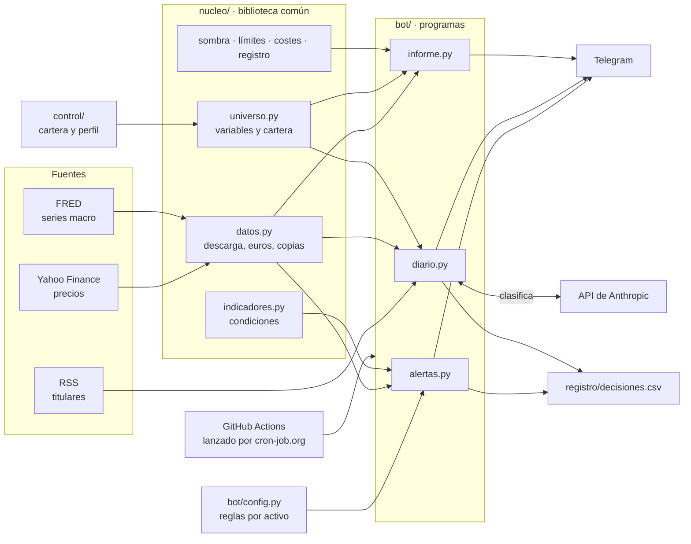

# Asistente financiero: seguimiento de cartera y alertas

[](https://github.com/iyantp/asistente-financiero/actions/workflows/tests.yml)


**Español** · [English](README.en.md)

Sistema personal que vigila una cartera de inversión y avisa por Telegram solo cuando pasa algo que importa. Se ejecuta solo en GitHub Actions y combina tres programas:

| Programa | Cuándo | Qué hace |
|---|---|---|
| **Alertas** (`bot/alertas.py`) | A diario, tras el cierre de EE. UU. | Evalúa reglas configurables (cruces de medias móviles, niveles de precio, caídas desde máximos y sus combinaciones) sobre precios de Yahoo Finance en euros, y avisa de cambios de tendencia, señales de entrada o salida y alarmas. |
| **Resumen diario** (`bot/diario.py`) | Lunes a viernes, antes de la apertura | Lee titulares de fuentes RSS fijas; un modelo de lenguaje (API de Anthropic) solo los **agrupa y clasifica**, y **reglas en código** deciden qué noticias mueven de verdad una variable de mercado y afectan a la cartera. |
| **Informe semanal** (`bot/informe.py`) | Lunes | Variables de mercado destacadas, qué parte de la semana de la cartera explica cada una, límites de riesgo del perfil, ideas en simulación y eventos de la semana. Solo cálculo, sin IA. |

> **Sobre los datos.** Este repositorio es la versión pública de un sistema que uso a diario. La cartera, el perfil y las reglas de `control/` y `bot/config.py` son **de ejemplo**: los activos son reales (para que todo funcione con datos de mercado), pero los pesos, fechas y tesis son ficticios. Nada de esto es asesoramiento financiero.

## Por qué existe

Empezó como un problema concreto: tenía una estrategia de cruce de medias móviles para cubrir caídas y no la ejecuté una semana en la que no estaba atento al mercado. La primera versión solo vigilaba ese cruce en el S&P 500. Después se generalizó a un motor de reglas para cualquier activo, a un filtro de noticias y a un informe semanal, siempre con la misma idea: **automatizar la atención, no la decisión**. Ningún aviso es una orden: todos invitan a revisar.

## Decisiones de diseño

Lo más interesante del proyecto no es el número de líneas, sino estas decisiones (y los errores que corrigieron):

- **El modelo clasifica; el código decide.** En el resumen diario, el modelo trabaja a temperatura 0, sin búsqueda web y sobre una lista cerrada de titulares; devuelve un JSON con la variable afectada, la dirección y el impacto de cada noticia. La relevancia la decide el código: una noticia solo pasa si su variable **se ha movido de verdad** ese día, es decir, si el último cambio de su aproximación diaria cumple $|z_t| \ge 1{,}5$, con $z_t = (\Delta x_t - \overline{\Delta x})/s_{\Delta x}$, donde la media y la desviación típica son las de los cambios de las 252 sesiones anteriores (la volatilidad cambia por régimen, así que se compara con el último año y no con todo el historial), y si su efecto típico sobre la cartera supera el 0,1 % por desviación típica. Así el resultado es reproducible, barato y no depende de que el modelo «opine». Hay un modo de prueba (`python bot/diario.py --prueba 3`) que clasifica los mismos titulares varias veces y mide la coincidencia.
- **Un marco fijo de variables de estado.** Unas pocas variables (tipos reales, inflación esperada, tipo a 2 años, dólar frente al euro y frente a una cesta de divisas, estrés de crédito, cobre, petróleo y VIX) en lugar de seguir «todas las noticias». Su efecto en cada activo se estima con una regresión semanal en euros, con las variables estandarizadas, estadísticos $t$ de Newey-West y un umbral de $|t| > 2{,}58$ para no ver relaciones donde solo hay azar (`analisis/exposiciones.ipynb`). El resultado es la **matriz de exposición** que usan los informes. El marco completo está en [`conocimiento/mercado.md`](conocimiento/mercado.md).
- **Validación de los datos, no solo del código.** Yahoo fecha las velas de divisas al inicio del día en Londres (desde 2011, aproximadamente), así que el euro/dólar del día $t$ es en realidad el de la noche de $t-1$. Lo detecté contrastándolo con FRED: la correlación de los cambios diarios es de 0,19 en la misma fecha y de 0,77 con la vela siguiente. Desde entonces, el histórico sale de FRED y solo la cola reciente sale de Yahoo, desplazada una vela (`nucleo.datos.alinear_fx`). Antes de esta corrección, todos los precios en euros mezclaban el cierre de un día con el cambio del anterior.
- **Evitar el sobreajuste en las reglas.** El barrido de combinaciones de medias (`analisis/archivo/barrido.ipynb`) elige mirando todo el histórico, y eso es optimista. `analisis/validacion.py` repite la elección *walk-forward* (elige con los años anteriores y prueba en el tramo siguiente) para medir ese optimismo, con comisiones y con la rentabilidad del efectivo (euríbor) mientras se está fuera del mercado.
- **Medir si las alertas sirven.** Cada alerta y cada noticia clasificada, incluidas las descartadas como grupo de control, se guarda en `registro/decisiones.csv` con la dirección que se espera del precio. `analisis/evaluar_registro.py` mide después qué hizo el precio.
- **Ideas antes que dinero: la cartera sombra.** Una idea nueva puede seguirse en simulación, con su regla de salida desde el primer día y sus costes reales de operar (`nucleo/sombra.py`, `nucleo/costes.py`), antes de invertir.
- **Una sola fuente de verdad y comprobaciones de coherencia.** Las posiciones viven solo en `control/cartera.csv`; las rutas, solo en `nucleo/rutas.py`. `nucleo.universo.coherencia()` comprueba que la cartera, la matriz y las reglas del bot cuadran entre sí, y el informe semanal avisa si algo se ha quedado desfasado (por ejemplo, una regla de una posición ya vendida).
- **Ejecución fiable.** El `schedule` de GitHub Actions retrasaba las ejecuciones varias horas o las saltaba, así que los workflows los lanza [cron-job.org](https://cron-job.org) por la API de GitHub a la hora exacta, con un token de permisos mínimos. Las alertas avisan antes de que el token caduque y cuando los datos de algún activo se quedan atrasados.
- **Reproducibilidad.** Versiones exactas en `requirements.lock` para los workflows; pruebas sin red ni claves (`tests/`), que se ejecutan en cada push; y un modo sin conexión (`FINANZAS_SIN_RED=1`) que trabaja con copias locales de los datos.

## Arquitectura



Las dependencias van en un solo sentido: `bot/` y `analisis/` usan `nucleo/`, y `nucleo/` no usa a ninguno de los dos.

```
├── nucleo/          biblioteca común (paquete Python instalable)
│   ├── datos.py         precios (Yahoo) y series (FRED), paso a euros, copias locales
│   ├── indicadores.py   condiciones: Cruce, Nivel, CaidaDesdeMaximo, MinimoMovil, SinNuevoMinimo, No, Todas, Alguna
│   ├── universo.py      variables de estado, cartera, factores, comprobación de coherencia
│   ├── sombra.py        cartera sombra (ideas simuladas con su salida)
│   ├── limites.py       límites de riesgo del perfil
│   ├── costes.py        comisiones por plataforma
│   ├── registro.py      registro de decisiones
│   ├── backtest.py      simulación y métricas para los análisis
│   └── rutas.py         único sitio con rutas de archivos
├── bot/             programas que se ejecutan solos
│   ├── config.py        reglas por activo, cartera sombra, fuentes RSS y modelo
│   ├── alertas.py · diario.py · informe.py
│   └── telegram.py      envío (o impresión por pantalla en modo demo)
├── control/         lo que decide el usuario: cartera.csv, cartera.md, perfil.md, calendario.csv (de ejemplo)
├── conocimiento/    marco de seguimiento del mercado
├── analisis/        cuadernos y scripts; archivo/ guarda los análisis superados
├── registro/        lo que escribe el bot (aquí, vacío)
├── tests/           pruebas sin red ni claves
├── docs/            manual del bot y guía de puesta en marcha
└── .github/workflows/  alertas, diario, informe y tests
```

## Prueba rápida

Requiere Python 3.10 o superior. La demo descarga precios de Yahoo Finance y FRED; no necesita Telegram ni ninguna clave.

```bash
git clone https://github.com/iyantp/asistente-financiero.git
cd asistente-financiero
python -m venv .venv && source .venv/bin/activate      # en Windows: .venv\Scripts\activate
pip install -r requirements.txt                          # dependencias + el paquete `nucleo`

python tests/test_reglas.py          # pruebas (sin red); o: pip install pytest && pytest -q tests
python bot/alertas.py --demo         # alertas y resumen del estado de cada activo, por pantalla
python bot/informe.py --demo         # informe semanal por pantalla
python -m nucleo.limites             # reparto por bloque y límites de riesgo
python -m nucleo.costes 5000         # coste de comprar y vender 5.000 € de un ETF
python bot/informe.py --sombra       # cartera sombra
```

El resumen diario necesita una clave de la API de Anthropic (`ANTHROPIC_API_KEY` en el entorno o en `.env`): `python bot/diario.py --demo`.

Para los análisis: `pip install -r requirements-analisis.txt` y `jupyter notebook analisis/`, o `python analisis/validacion.py SPY EURUSD=X`.

## Montar tu propio bot

La guía paso a paso (bot de Telegram, secrets de GitHub, clave de Anthropic, programación con cron-job.org o con el `schedule` de GitHub, y cómo adaptar la cartera y las reglas) está en [`docs/bot.md`](docs/bot.md). En resumen:

1. Haz un fork (o una copia) de este repositorio.
2. Crea un bot con @BotFather en Telegram y obtén tu `chat_id`.
3. Añade `TELEGRAM_BOT_TOKEN`, `TELEGRAM_CHAT_ID` y, si quieres el resumen diario, `ANTHROPIC_API_KEY` como secrets del repositorio.
4. Edita `control/cartera.csv` y `bot/config.py` con tus activos y reglas, y reejecuta `analisis/exposiciones.ipynb`.
5. Lánzalo desde *Actions → alertas → Run workflow* y prográmalo.

## Análisis incluidos

| Análisis | Pregunta |
|---|---|
| `analisis/archivo/analisis.ipynb` | ¿Qué habrían hecho las estrategias de cruce de medias en el S&P 500 y en el oro, en euros y con retraso y comisiones, frente a mantener siempre? |
| `analisis/archivo/barrido.ipynb` | ¿Hay combinaciones de medias que rindan casi lo mismo que mantener con bastante menos volatilidad? ¿Son estables en el tiempo? |
| `analisis/validacion.py` | ¿Cuánto sobreestima el barrido lo que cabe esperar fuera de muestra (*walk-forward*)? |
| `analisis/exposiciones.ipynb` | ¿Cómo se mueve cada activo cuando se mueve cada variable de estado? (genera la matriz de exposición) |
| `analisis/candidatas.ipynb` | ¿Hay variables que expliquen un activo mejor que las variables de estado? |
| `analisis/riesgo_cartera.py` | Volatilidad y caídas de la cartera en conjunto, contribución al riesgo, cubrir o no el dólar, episodios de tensión. |
| `analisis/evaluar_registro.py` | ¿Acertaron las alertas y la clasificación de noticias? |

## Limitaciones

- Los precios de Yahoo Finance no son una fuente oficial: pueden faltar días o cambiar el formato. El bot avisa si los datos de un activo se quedan atrasados y, si falla una descarga, usa la última copia local.
- Las regresiones de la matriz de exposición cambian con el régimen de mercado (se estiman desde 2012 y desde 2022). Son una guía para filtrar noticias, no una predicción.
- El registro de decisiones necesita meses de datos antes de poder concluir algo sobre la utilidad de las alertas.
- Las reglas de ejemplo ilustran el sistema; no son recomendaciones.

## Desarrollo

Diseñado y dirigido por Iyán Tuñón Pérez, estudiante de Matemáticas en la Universidad de Oviedo. El código se ha escrito con asistencia de IA (Claude): el diseño del sistema, las reglas, el marco de variables y las decisiones de validación son míos, y cada cambio se ha comprobado con pruebas y con datos reales antes de usarlo.

Los comentarios y nombres del código están en español porque es una herramienta de uso personal.

## Licencia

[MIT](LICENSE).
