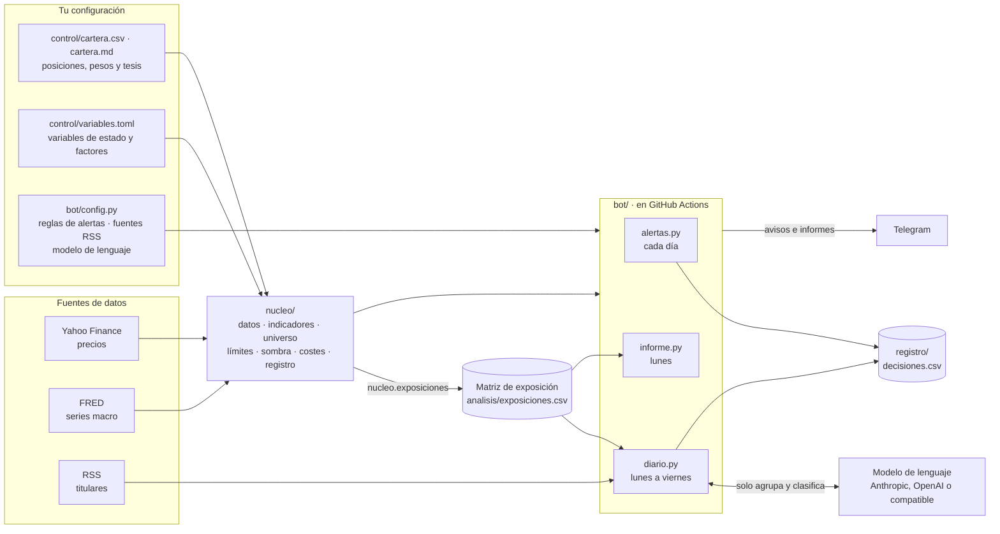

# Asistente financiero: seguimiento de cartera y alertas

[](https://github.com/iyantp/asistente-financiero/actions/workflows/tests.yml)


**Español** · [English](README.en.md)

Sistema que vigila una cartera de inversión y avisa por Telegram solo cuando pasa algo que importa. Se ejecuta solo en GitHub Actions, sin servidor propio, y combina tres programas:

| Programa | Cuándo | Qué hace |
|---|---|---|
| **Alertas** (`bot/alertas.py`) | A diario, tras el cierre de EE. UU. | Evalúa tus reglas sobre cualquier activo de Yahoo Finance (cruces de medias, niveles de precio, caídas desde máximos, rupturas, variaciones y sus combinaciones) y avisa de cambios de tendencia, señales de entrada y salida y alarmas. |
| **Resumen diario** (`bot/diario.py`) | Lunes a viernes, antes de la apertura | Lee titulares de tus fuentes RSS. Un modelo de lenguaje (Anthropic, OpenAI o cualquier API compatible) solo los **agrupa y clasifica**; **reglas en código** deciden qué noticias han movido de verdad una de tus variables de mercado y afectan a tu cartera. |
| **Informe semanal** (`bot/informe.py`) | Lunes | Variables de mercado destacadas, qué parte de la semana de la cartera explica cada una, límites de riesgo, ideas en simulación y eventos de la semana. Solo cálculo, sin IA. |

> Todo lo personal es configuración: la cartera, las variables de mercado, las reglas de las alertas, las fuentes de noticias y el modelo de lenguaje. Lo que hay en este repositorio es **mi configuración, como ejemplo**: si no cambias algo, se queda así. Los pesos de la cartera son ficticios. Nada de esto es asesoramiento financiero.

## Por qué existe

Partió de dos intenciones. Por un lado, programar por mi cuenta las alertas y los avisos que me parecieran convenientes, personalizados y sin pagar un servicio por ello. Por otro, automatizar la información: recibir solo las noticias y los datos que afectan a lo que tengo.

## Configuración

| Qué | Dónde | Ejemplo incluido |
|---|---|---|
| Cartera: posiciones, pesos, tesis | `control/cartera.csv`, `control/cartera.md` | 7 posiciones con pesos ficticios |
| Perfil y límites de riesgo | `control/perfil.md`, `nucleo/limites.py` | Cripto + especulación ≤ 15 % |
| Variables de mercado, aproximaciones diarias y factores sectoriales | `control/variables.toml` | Tipos reales, inflación esperada, tipo a 2 años, dólar, crédito, cobre, petróleo y VIX |
| Reglas de las alertas | `bot/config.py` (`ACTIVOS`) | S&P 500, Nasdaq 100, oro, tierras raras, bitcoin y ether |
| Fuentes de noticias | `bot/config.py` (`FUENTES_RSS`) | Fed, BCE, CNBC, WSJ, FT, CoinDesk… |
| Modelo de lenguaje | `bot/config.py` (`DIARIO_PROVEEDOR`, `DIARIO_MODELO`…) | Anthropic, Claude Sonnet |
| Ideas en simulación | `bot/config.py` (`SOMBRA`) | Oro con tope de pérdida del 12 % |
| Calendario de eventos | `control/calendario.csv` | Fed, BCE, IPC de EE. UU. |
| Horarios | El programador que uses (cron-job.org o el `schedule` de GitHub) | Alertas a las 23:15, resumen a las 06:20, informe los lunes a las 06:40 (hora de Madrid) |

Los datos de mercado vienen de Yahoo Finance (precios) y FRED (series macroeconómicas).

### Tus reglas de alertas

Cada regla es una línea de `bot/config.py`, sobre cualquier ticker de Yahoo Finance (acciones, ETF, índices, divisas, materias primas, cripto). Algunos ejemplos:

```python
Activo("Apple", "AAPL", alarma=Nivel(250)),                                    # el precio supera 250 $
Activo("S&P 500 (€)", "SPY", divisa="EURUSD=X", alarma=No(Cruce(75, 500))),    # cruce bajista de medias, en euros
Activo("Nasdaq 100", "QQQ", alarma=Variacion(-0.03)),                          # cae un 3 % o más en un día
Activo("Oro", "GLD", alarma=CaidaDesdeMaximo(0.15)),                           # 15 % bajo su máximo de un año
Activo("Bitcoin", "BTC-USD", continuo=True, alarma=MaximoMovil(252)),          # nuevo máximo de un año
Activo("Ether", "ETH-USD", continuo=True,
       alarma=Todas((Cruce(6, 20), SinNuevoMinimo(5, 60)))),                   # combinación de condiciones
```

Además de alarmas, un activo puede tener **seguimiento** (avisa cuando cambia una tendencia) y una **estrategia** con fecha de entrada (avisa de la entrada y de la salida). Las condiciones disponibles y cómo añadir una nueva están en el [manual](docs/bot.md#alertas-reglas-por-activo).

## Decisiones de diseño

- **El modelo clasifica; el código decide.** En el resumen diario, el modelo trabaja a temperatura 0, sin búsqueda web y sobre una lista cerrada de titulares; devuelve un JSON con la variable afectada, la dirección y el impacto de cada noticia. La relevancia la decide el código: una noticia solo pasa si su variable **se ha movido de verdad** ese día, es decir, si el último cambio de su aproximación diaria cumple $|z_t| \ge 1{,}5$, con $z_t = (\Delta x_t - \overline{\Delta x})/s_{\Delta x}$, donde la media y la desviación típica son las de los cambios de las 252 sesiones anteriores (la volatilidad cambia por régimen, así que se compara con el último año y no con todo el historial), y si su efecto típico sobre la cartera supera el 0,1 % por desviación típica. Así el resultado es reproducible, barato y no depende de que el modelo «opine». Hay un modo de prueba (`python bot/diario.py --prueba 3`) que clasifica los mismos titulares varias veces y mide la coincidencia.
- **Un método, no unas variables concretas.** El mercado se lee con unas pocas variables de estado en lugar de seguir «todas las noticias». Las variables se definen en `control/variables.toml`, y todo lo demás sale de ahí: la matriz de exposición, las instrucciones del modelo, el filtro de noticias y el informe semanal. Cambiar de variables es editar ese archivo y regenerar la matriz.
- **La matriz de exposición.** Mide cómo se mueve cada activo de la cartera cuando se mueve cada variable: regresiones semanales en euros con las variables estandarizadas, estadísticos $t$ de Newey-West y un umbral de $|t| > 2{,}58$ para no ver relaciones donde solo hay azar. Da dos lecturas: el efecto típico (para las noticias) y la exposición directa (para atribuir la semana). Se genera con `python -m nucleo.exposiciones`; el método está documentado en [`nucleo/exposiciones.py`](nucleo/exposiciones.py) y el marco completo, en [`conocimiento/mercado.md`](conocimiento/mercado.md).
- **Validación de los datos, no solo del código.** Yahoo fecha las velas de divisas al inicio del día en Londres (desde 2011, aproximadamente), así que el euro/dólar del día $t$ es en realidad el de la noche de $t-1$. Lo detecté contrastándolo con FRED: la correlación de los cambios diarios es de 0,19 en la misma fecha y de 0,77 con la vela siguiente. Desde entonces, el histórico sale de FRED y solo la cola reciente sale de Yahoo, desplazada una vela (`nucleo.datos.alinear_fx`).
- **Medir si las alertas sirven.** Cada alerta y cada noticia clasificada, incluidas las descartadas como grupo de control, se guarda en `registro/decisiones.csv` con la dirección que se espera del precio. `analisis/evaluar_registro.py` mide después qué hizo el precio.
- **Ideas antes que dinero: la cartera sombra.** Una idea nueva puede seguirse en simulación, con su regla de salida desde el primer día y sus costes reales de operar (`nucleo/sombra.py`, `nucleo/costes.py`), antes de invertir.
- **Una sola fuente de verdad y comprobaciones de coherencia.** Cada dato de configuración vive en un solo sitio y las rutas, solo en `nucleo/rutas.py`. `python -m nucleo.universo` comprueba que la cartera, las variables y la matriz cuadran entre sí; las pruebas y el informe semanal comprueban además las reglas del bot, y el informe avisa si algo se ha quedado desfasado (por ejemplo, una regla de una posición ya vendida).
- **Independiente del proveedor de IA.** `bot/llm.py` habla con la API de Anthropic y con cualquier API compatible con la de OpenAI (OpenAI, Gemini, Mistral, Groq, OpenRouter, Ollama en local…) solo con `requests`.
- **Ejecución fiable.** El `schedule` de GitHub Actions retrasaba las ejecuciones varias horas o las saltaba, así que los workflows los lanza [cron-job.org](https://cron-job.org) por la API de GitHub a la hora exacta, con un token de permisos mínimos. Las alertas avisan antes de que el token caduque y cuando los datos de algún activo se quedan atrasados.
- **Reproducibilidad.** Versiones exactas en `requirements.lock` para los workflows; pruebas sin red ni claves (`tests/`), que se ejecutan en cada push; un modo `--demo` que imprime en vez de enviar; y un modo sin conexión (`FINANZAS_SIN_RED=1`) que trabaja con copias locales de los datos.

## Arquitectura



Las dependencias van en un solo sentido: `bot/` y `analisis/` usan `nucleo/`, y `nucleo/` no usa a ninguno de los dos.

```
├── control/         tu configuración de datos: cartera.csv, cartera.md, perfil.md, calendario.csv, variables.toml
├── bot/             programas que se ejecutan solos
│   ├── config.py        reglas de alertas, cartera sombra, fuentes RSS y modelo de lenguaje
│   ├── alertas.py · diario.py · informe.py
│   ├── llm.py           llamada al modelo de lenguaje (Anthropic o compatible con OpenAI)
│   └── telegram.py      envío (o impresión por pantalla en modo demo)
├── nucleo/          biblioteca común (paquete Python instalable)
│   ├── datos.py         precios (Yahoo) y series (FRED), paso a euros, copias locales
│   ├── indicadores.py   condiciones: Cruce, Nivel, Variacion, CaidaDesdeMaximo, MaximoMovil, MinimoMovil, SinNuevoMinimo, No, Todas, Alguna
│   ├── universo.py      lee la cartera y las variables; comprobación de coherencia
│   ├── exposiciones.py  matriz de exposición
│   ├── sombra.py        cartera sombra (ideas simuladas con su salida)
│   ├── limites.py       límites de riesgo del perfil
│   ├── costes.py        comisiones por plataforma
│   ├── registro.py      registro de decisiones
│   ├── backtest.py      regresión con Newey-West y simulación
│   └── rutas.py         único sitio con rutas de archivos
├── conocimiento/    marco de seguimiento del mercado (por qué estas variables)
├── analisis/        matriz de exposición y evaluación del registro
├── registro/        lo que escribe el bot (aquí, vacío)
├── tests/           pruebas sin red ni claves
├── docs/            manual del bot y guía de puesta en marcha
└── .github/workflows/  alertas, diario, informe y tests
```

## Prueba rápida

Requiere Python 3.10 o superior. La demo descarga precios de Yahoo Finance y FRED; no necesita Telegram ni ninguna clave.

```bash
git clone https://github.com/iyantp/asistente-financiero.git
cd asistente-financiero
python -m venv .venv && source .venv/bin/activate      # en Windows: .venv\Scripts\activate
pip install -r requirements.txt                          # dependencias + el paquete `nucleo`

python tests/test_reglas.py          # pruebas (sin red); o: pip install pytest && pytest -q tests
python -m nucleo.universo            # comprueba la configuración (variables, cartera y matriz)
python bot/alertas.py --demo         # alertas y resumen del estado de cada activo, por pantalla
python bot/informe.py --demo         # informe semanal por pantalla
python -m nucleo.exposiciones        # regenera la matriz de exposición
python -m nucleo.limites             # reparto por bloque y límites de riesgo
python bot/informe.py --sombra       # cartera sombra
```

El resumen diario necesita la clave de tu modelo de lenguaje (por defecto, `ANTHROPIC_API_KEY` en el entorno o en `.env`): `python bot/diario.py --demo`.

## Montar tu propio bot

La guía paso a paso está en [`docs/bot.md`](docs/bot.md): bot de Telegram, secrets de GitHub, modelo de lenguaje, horarios con cron-job.org o con el `schedule` de GitHub, y cómo adaptar la cartera, las variables y las reglas. En resumen:

1. Haz un fork (o una copia) de este repositorio.
2. Crea un bot con @BotFather en Telegram y obtén tu `chat_id`.
3. Añade `TELEGRAM_BOT_TOKEN`, `TELEGRAM_CHAT_ID` y, si quieres el resumen diario, la clave de tu modelo de lenguaje como secrets del repositorio.
4. Cambia lo que quieras de la configuración (lo que no cambies se queda como en el ejemplo) y, si has cambiado la cartera o las variables, regenera la matriz con `python -m nucleo.exposiciones`.
5. Lánzalo desde *Actions → alertas → Run workflow* y prográmalo.

## Limitaciones

- Los precios de Yahoo Finance no son una fuente oficial: pueden faltar días o cambiar el formato. El bot avisa si los datos de un activo se quedan atrasados y, si falla una descarga, usa la última copia local.
- La matriz de exposición mide relaciones contemporáneas que cambian con el régimen de mercado (por eso se estima también solo desde 2022). Es una guía para filtrar noticias, no una predicción.
- El registro de decisiones necesita meses de datos antes de poder concluir algo sobre la utilidad de las alertas.
- Las reglas de ejemplo ilustran el sistema; no son recomendaciones.

## Desarrollo

Diseñado y dirigido por Iyán Tuñón Pérez, estudiante de Matemáticas en la Universidad de Oviedo. El código se ha escrito con asistencia de IA (Claude): el diseño del sistema, las reglas, el marco de variables y las decisiones de validación son míos, y cada cambio se ha comprobado con pruebas y con datos reales antes de usarlo.

Los comentarios y nombres del código están en español porque nació como herramienta de uso personal.

## Licencia

[MIT](LICENSE).
