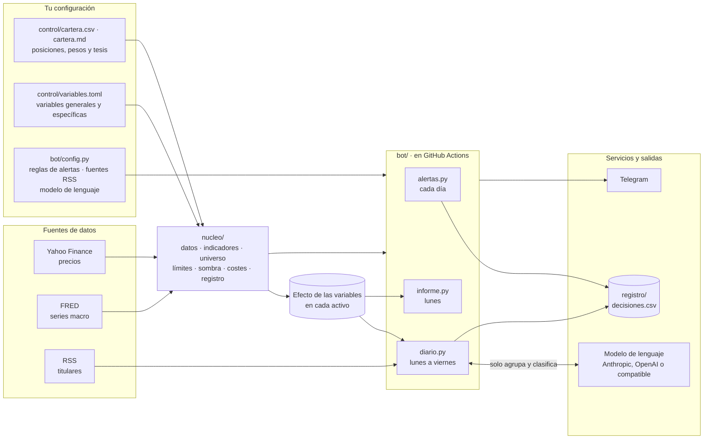

# Asistente financiero

[](https://github.com/iyantp/asistente-financiero/actions/workflows/tests.yml)


**Español** · [English](README.en.md)

Un asistente que vigila tus inversiones y te avisa por Telegram **solo cuando pasa algo que importa**. Funciona solo, en GitHub, sin ordenador encendido ni servidor propio, y hace tres cosas:

1. **Alertas con tus propias reglas.** «Avísame si el oro cae un 15 % desde su máximo», «si el S&P 500 pierde su media de 200 sesiones», «si el bitcoin marca un máximo anual». Lo que harías con un servicio de pago como TradingView, sobre cualquier activo de Yahoo Finance.
2. **Un resumen de noticias filtrado.** Cada mañana lee los titulares de las fuentes que elijas y te manda solo los que afectan a lo que tienes, con el motivo. Una IA ordena los titulares; la decisión de qué te importa la toman reglas fijas, así que es predecible.
3. **Un sistema para entender qué mueve tu cartera.** Mide cómo afectan las grandes variables del mercado (tipos de interés, dólar, inflación, petróleo…) a cada uno de tus activos y cómo se relacionan tus activos entre sí. Cada lunes te explica en un informe qué ha movido tu cartera esa semana.

> Todo lo personal es configuración: tu cartera, tus reglas, tus fuentes, tus variables y el proveedor de IA. Lo que hay aquí es **mi configuración, como ejemplo**: lo que no cambies se queda así. Los pesos de la cartera son ficticios. Nada de esto es asesoramiento financiero.

## Por qué existe

Partió de dos intenciones. Por un lado, programar por mi cuenta las alertas y los avisos que me parecieran convenientes, personalizados y sin pagar un servicio por ello. Por otro, automatizar la información: recibir solo las noticias y los datos que afectan a lo que tengo.

## Cómo entiende el mercado

El asistente no sigue «todas las noticias». Usa dos tipos de variables:

- **Variables generales**, que mueven a todos los activos: la bolsa mundial, los tipos de interés, el crédito, la inflación, el dólar, las materias primas…
- **Variables específicas** de un activo concreto, para lo que las generales no explican: el litio y las mineras para un fondo de tierras raras, o el bitcoin para el ether.

Con datos históricos mide cuánto se mueve cada uno de tus activos cuando se mueve cada variable. De ahí salen tres cosas:
- **Qué noticias te afectan:** una noticia solo pasa el filtro si mueve una variable que mueve tu cartera y si esa variable se ha movido de verdad.
- **Qué explica tu semana:** el informe del lunes reparte el movimiento de la cartera entre las variables.
- **Por qué tus activos se mueven juntos,** cosa que importa para saber si de verdad estás diversificado.

Las variables de este repositorio son las mías, como ejemplo; el método funciona con las que tú elijas. El detalle técnico está en el [apéndice](#apéndice-técnico).

## Pruébalo

Necesitas Python 3.10 o superior. La demo descarga precios de internet; no hace falta Telegram ni ninguna clave.

```bash
git clone https://github.com/iyantp/asistente-financiero.git
cd asistente-financiero
python -m venv .venv
source .venv/bin/activate
pip install -r requirements.txt
python bot/alertas.py --demo
python bot/informe.py --demo
```

En Windows, la cuarta línea es `.venv\Scripts\activate`. Las dos últimas muestran por pantalla las alertas y el informe semanal de la cartera de ejemplo. El resumen de noticias necesita una clave de IA (por defecto, `ANTHROPIC_API_KEY`): `python bot/diario.py --demo`.

## Configúralo para ti

| Qué | Dónde |
|---|---|
| Tu cartera: posiciones, pesos y en qué moneda está cada una | `control/cartera.csv` (y tus notas en `control/cartera.md`) |
| Tus reglas de alertas | `bot/config.py` |
| Tus fuentes de noticias | `bot/config.py` (`FUENTES_RSS`) |
| El proveedor de IA (Anthropic, OpenAI, Gemini, un modelo en tu ordenador…) | `bot/config.py` (`DIARIO_*`) |
| Tus variables de mercado | `control/variables.toml` |
| Tus límites de riesgo | `control/perfil.md` y `nucleo/limites.py` |
| Eventos de la semana (Fed, BCE, IPC…) | `control/calendario.csv` |
| A qué hora llega cada cosa | El programador que uses (ver la guía) |

### Tus reglas de alertas

Cada regla es una línea de `bot/config.py`:

```python
Activo("Apple", "AAPL", alarma=Nivel(250)),                               # el precio supera 250 $
Activo("Nasdaq 100", "QQQ", alarma=Variacion(-0.03)),                     # cae un 3 % o más en un día
Activo("Oro", "GLD", alarma=CaidaDesdeMaximo(0.15)),                      # 15 % bajo su máximo de un año
Activo("Bitcoin", "BTC-USD", continuo=True, alarma=MaximoMovil(252)),     # nuevo máximo de un año
Activo("S&P 500 (€)", "SPY", divisa="EURUSD=X", alarma=No(Cruce(75, 500))),   # cruce de medias, en euros
```

Las condiciones se pueden combinar («esto y aquello», «esto o aquello»). Un activo también puede tener **seguimiento** (te avisa cuando cambia una tendencia) y una **estrategia** con fecha de compra (te avisa de la entrada y de la salida). Todas las condiciones están en el [manual](docs/bot.md#alertas-reglas-por-activo).

### Montar tu propio bot

La guía paso a paso está en [`docs/bot.md`](docs/bot.md). En resumen:
1. Haz una copia (*fork*) de este repositorio.
2. Crea un bot de Telegram con @BotFather.
3. Guarda el token del bot, tu número de chat y, si quieres el resumen de noticias, la clave de tu IA como *secrets* del repositorio.
4. Cambia la configuración que quieras.
5. Lánzalo desde la pestaña *Actions* y prográmalo.

## Limitaciones

- Los precios vienen de Yahoo Finance, que no es una fuente oficial: a veces faltan días. El bot te avisa si los datos de un activo se quedan atrasados.
- Las relaciones entre variables y activos cambian con el tiempo. Sirven para filtrar y entender, no para predecir.
- Hacen falta meses de uso antes de poder medir si las alertas aciertan (el sistema las va registrando para comprobarlo).
- Las reglas de ejemplo ilustran el sistema; no son recomendaciones.

## Desarrollo

Diseñado y dirigido por Iyán Tuñón Pérez, estudiante de Matemáticas en la Universidad de Oviedo. El código se ha escrito con asistencia de IA (Claude): el diseño del sistema, las reglas, el marco de variables y las decisiones de validación son míos, y cada cambio se ha comprobado con pruebas y con datos reales antes de usarlo. El código está en español porque nació como herramienta de uso personal.

Licencia [MIT](LICENSE).

---

## Apéndice técnico

### A. Cómo se mide el efecto de las variables

**En producción: la matriz de exposición** (`nucleo/exposiciones.py`, `python -m nucleo.exposiciones`). Las variables generales se definen en `control/variables.toml` y las específicas en su sección `[factores]`. Para cada activo de la cartera y cada variable general, la matriz estima con datos semanales en euros cuánto se mueve el activo cuando la variable se mueve una desviación típica, en dos lecturas:
- **Efecto típico**, $\gamma_k$: regresión simple, que incluye cómo se mueven a la vez las demás variables. Es la que usa el resumen diario para las noticias.
- **Exposición directa**, $\beta_k$: regresión múltiple, con las demás fijas. Es la que usa el informe semanal para atribuir la semana.

Se relacionan por $\gamma_k = \sum_j \beta_j \rho_{jk}$. Inferencia: estadísticos $t$ de Newey-West, con un umbral de $|t| > 2{,}58$.

**En construcción: un modelo de factores de riesgo** (`control/factores.toml`, `nucleo/factores.py`), al estilo de los modelos de Barra o del *Factor Lens* de Two Sigma. Cada activo se describe como

$$r_{a,t} = \alpha_a + \sum_k \beta_{a,k}\, f_{k,t} + \varepsilon_{a,t},$$

y de ahí sale también la correlación entre activos, $\Sigma = B\,\Omega\,B^\top + D$. Frente a la matriz:
- **Factores negociables con dato diario** (ETF y diferencias entre ETF) en lugar de series macroeconómicas que se publican con retraso.
- **Ortogonalización en un orden elegido** (Gram-Schmidt), para que factores solapados, como el euro y el dólar, no se repartan el mérito de forma inestable.
- **Factores específicos** de cada posición, limpios de los generales.
- **Conversión de divisa exacta,** en vez de estimada como un factor más.

Está pendiente estimar exposiciones que varían en el tiempo, contraer las estimaciones hacia valores de referencia, separar las correlaciones en calma y en tensión (VIX, MOVE y diferencial de crédito) y validar el modelo frente a lo que ocurre después.

### B. Decisiones de diseño

- **El modelo de lenguaje clasifica; el código decide.** El resumen diario usa el modelo a temperatura 0, sin búsqueda web y sobre una lista cerrada de titulares; el modelo devuelve un JSON con la variable afectada, la dirección y el impacto de cada noticia. Una noticia solo pasa si su variable se ha movido de verdad ese día: el último cambio de su aproximación diaria debe cumplir $|z_t| \ge 1{,}5$, donde $z_t = (\Delta x_t - \overline{\Delta x})/s_{\Delta x}$ frente a las 252 sesiones anteriores. Además, su efecto típico sobre la cartera debe ser de al menos un 0,1 % por desviación típica. `python bot/diario.py --prueba 3` mide la consistencia de la clasificación.
- **Independiente del proveedor de IA.** `bot/llm.py` habla con la API de Anthropic y con cualquier API compatible con la de OpenAI solo con `requests`.
- **Validación de los datos, no solo del código.** Dos ejemplos:
  - Yahoo fecha las velas de divisas al inicio del día en Londres, así que el EUR/USD del día $t$ es el de la noche de $t-1$: la correlación de los cambios con FRED es de 0,19 en la misma fecha y de 0,77 con la vela siguiente. Se corrige en `nucleo.datos.alinear_fx`.
  - URTH (MSCI World) apenas se negoció en 2012–2014: 151 días sin cambio en 2012 y una correlación de 0,29 con el S&P 500. Sus datos solo se usan desde 2015.
- **Medir si las alertas sirven.** Cada alerta y cada noticia clasificada, incluidas las descartadas como grupo de control, se guarda en `registro/decisiones.csv` con la dirección que se espera del precio. `analisis/evaluar_registro.py` mide después qué hizo el precio.
- **Ideas antes que dinero.** La cartera sombra (`nucleo/sombra.py`) sigue ideas en simulación, con su regla de salida desde el primer día y costes reales de operar (`nucleo/costes.py`).
- **Una sola fuente de verdad y comprobaciones de coherencia.** Cada dato de configuración vive en un solo sitio. `python -m nucleo.universo` comprueba que cartera, variables y matriz cuadran; las pruebas y el informe semanal comprueban además las reglas del bot.
- **Ejecución fiable.** El `schedule` de GitHub Actions retrasaba o saltaba ejecuciones, así que los workflows los lanza [cron-job.org](https://cron-job.org) por la API de GitHub, con un token de permisos mínimos. Las alertas avisan antes de que el token caduque.
- **Reproducibilidad.** Versiones exactas en `requirements.lock`; pruebas sin red ni claves en cada push; modo `--demo`; modo sin conexión (`FINANZAS_SIN_RED=1`) con copias locales de los datos.

### C. Arquitectura



Las dependencias van en un solo sentido: `bot/` y `analisis/` usan `nucleo/`, y `nucleo/` no usa a ninguno de los dos.

```
├── control/         configuración de datos: cartera.csv, cartera.md, perfil.md, calendario.csv,
│                    variables.toml (variables del sistema actual), factores.toml (modelo de factores)
├── bot/             programas que se ejecutan solos
│   ├── config.py        reglas de alertas, cartera sombra, fuentes RSS y modelo de lenguaje
│   ├── alertas.py · diario.py · informe.py
│   ├── llm.py           llamada al modelo de lenguaje (Anthropic o compatible con OpenAI)
│   └── telegram.py      envío (o impresión por pantalla en modo demo)
├── nucleo/          biblioteca común (paquete Python instalable)
│   ├── datos.py         precios (Yahoo) y series (FRED), conversión de divisa, copias locales
│   ├── indicadores.py   condiciones de las alertas
│   ├── universo.py      lee cartera y variables; comprobación de coherencia
│   ├── exposiciones.py  matriz de exposición (en producción)
│   ├── factores.py      modelo de factores (en construcción)
│   ├── sombra.py · limites.py · costes.py · registro.py · backtest.py
│   └── rutas.py         único sitio con rutas de archivos
├── conocimiento/    marco de seguimiento del mercado: por qué estas variables
├── analisis/        matriz de exposición y evaluación del registro
├── registro/        lo que escribe el bot (aquí, vacío)
├── tests/           pruebas sin red ni claves
├── docs/            manual del bot y guía de puesta en marcha
└── .github/workflows/  alertas, diario, informe y tests
```

### D. Comandos útiles

```bash
python tests/test_reglas.py          # pruebas (sin red)
python -m nucleo.universo            # ¿cuadra la configuración?
python -m nucleo.exposiciones        # regenera la matriz de exposición
python -m nucleo.limites             # reparto por bloques y límites de riesgo
python -m nucleo.costes 5000         # coste de comprar y vender 5.000 € de un ETF
python bot/informe.py --sombra       # cartera sombra
python bot/diario.py --prueba 3      # consistencia de la clasificación de noticias
```
